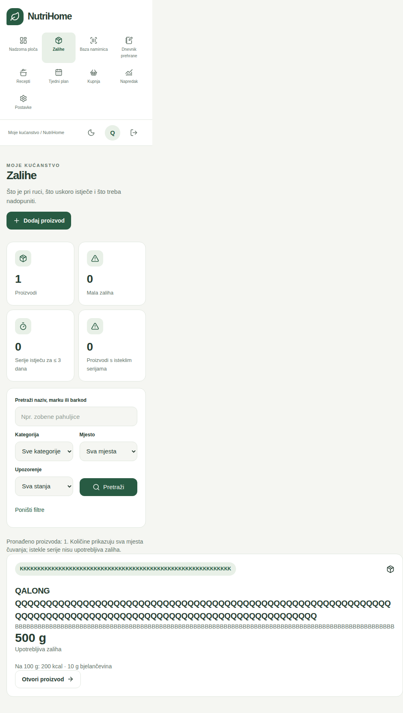
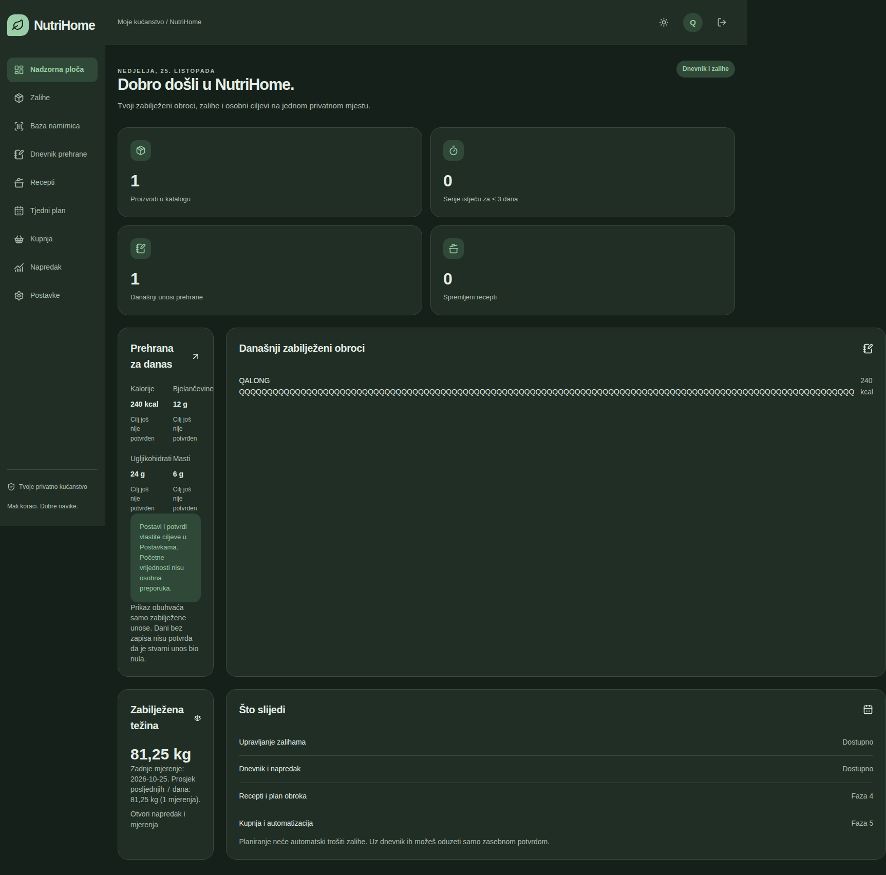
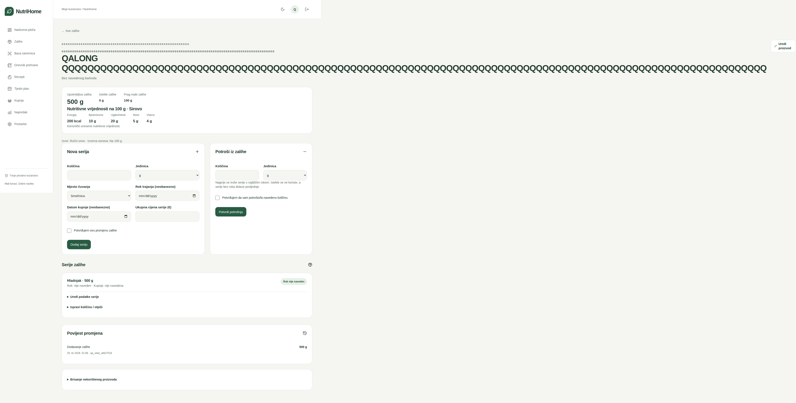
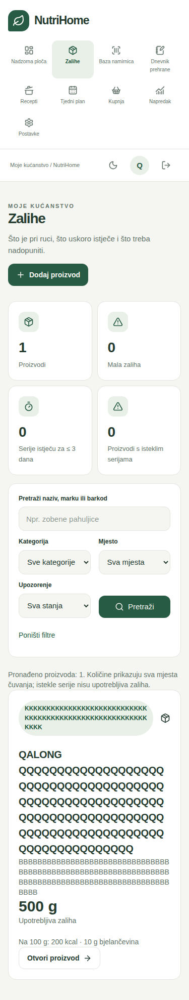
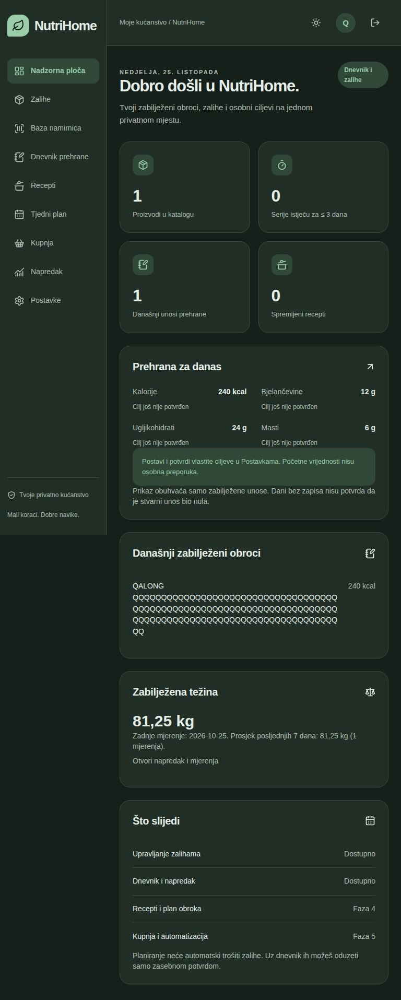
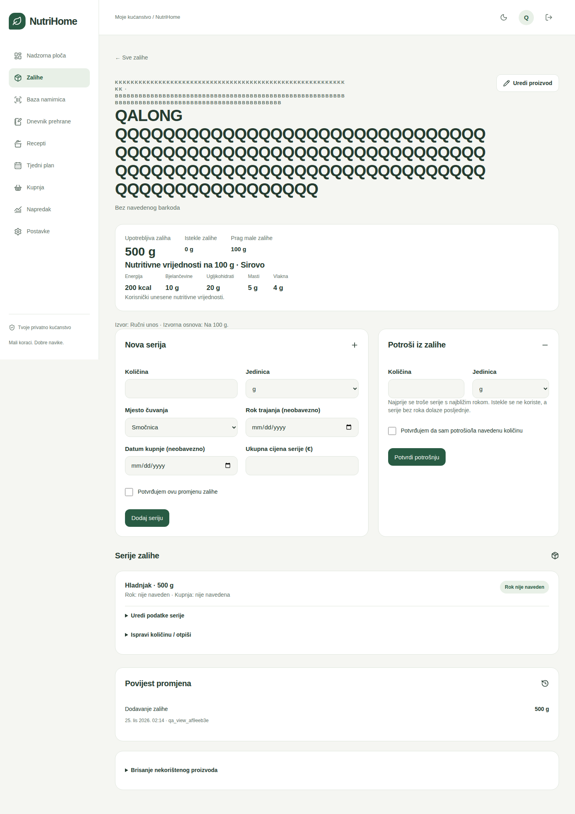

# NutriHome — sveobuhvatni QA audit

Datum: 25.10.2026. Polazna razvojna grana: `phase-3-6-local-food-db`, commit `3d9c7dc8b90274da9eeae375b817f6267eb05aa6`. QA grana: `qa-comprehensive-audit`. PR: https://github.com/fluxara-del/nutrihome/pull/2 (prema razvojnoj grani, ne prema `main`). Nema javne objave aplikacije.

## Opseg i sigurnost testnih podataka

Sve naredbe koje pišu podatke koriste novu privremenu SQLite bazu s prefiksom `nutrihome-e2e-`, `nutrihome-inventory-`, `nutrihome-nutrition-` ili `nutrihome-qa-perf-`. QA browser i benchmark odbijaju neodgovarajući testni kontekst. Kreirani su samo testni računi i kućanstva; lozinke su nasumične i nisu spremljene u Git. Produkcijska baza, korisnički zapisi i tajne nisu otvarani niti resetirani. Nema nove migracije ili `prisma db push`.

Browser poslužitelj sluša isključivo `127.0.0.1`. Docker smoke koristi zasebni Compose projekt i privremene volumene te port vezan na loopback. Brisanje njegove testne baze/volumena nije postupak nad korisničkom instalacijom.

## Testirane stranice

| Stranica | Provjeren sadržaj i stanja |
| --- | --- |
| `/prijava` | Prazan obrazac, pogrešna lozinka, valjana prijava, privatni session cookie, CSRF, odjava i opoziv sesije |
| `/` | Stvarni brojači, dnevni makronutrijenti, ciljevi, zadnja težina, prazno i popunjeno stanje, dug naziv obroka |
| `/zalihe` | Pretraga naziva/marke/barkoda, dijakritika, kategorija, lokacija, mala/istekla zaliha, paginacija, dugi tekstovi |
| `/zalihe/novo` | Validacija nutritivnih vrijednosti, gustoće, mase komada i barkoda; nepoznata vlakna |
| `/zalihe/[id]` | Dodavanje serije, zasebna potvrda, FEFO potrošnja, nedovoljna zaliha, uređivanje serije, otpis, povijest i zaštita povezanih podataka |
| `/zalihe/[id]/uredi` | Uređivanje, nepoznata vlakna, ograničenje promjene sirovo/kuhano uz aktivne zalihe |
| `/namirnice` | Stvarni ugrađeni katalog, banana, hrvatski/engleski nazivi, sirovo/kuhano, odabir i potvrda, lokalni barkod, OCR i ručni unos |
| `/dnevnik` | Unos/izmjena/brisanje, 120 g banane, pretvorbe, snapshotovi, zasebno potvrđeno trošenje zalihe, osobna izolacija |
| `/napredak` | Unos/izmjena/brisanje težine, 7/30 dana, graf i tablica, dani bez zapisa, mobilno pomicanje unutar tablice |
| `/postavke` | Ciljevi i potvrda, validacija, verzioniranje, prikaz u dnevniku i na nadzornoj ploči |
| `/postavke/baza-namirnica` | Broj/verzija/SHA-256, ovlasti prvog računa, odbijanje neispravnog uvoza, lokalni obrazac uvoza |
| `/recepti`, `/plan`, `/kupnja` | Samo postojeći placeholderi i jasna poruka o budućim fazama; nisu testirani kao dovršeni moduli |

## Vizualni pregled i responzivnost

Matrica obuhvaća **375×812, 390×844, 768×1024 i 1440×900**, svijetlu i tamnu temu: 104 navigacije kroz zaštićene stranice i osam prikaza prijave, ukupno **112 snimki po platformi**. Prijava u tamnoj varijanti u matrici postavlja spremljenu temu; stvarni prekidač i zadržavanje teme nakon ponovnog učitavanja provjerava postojeći foundation E2E.

Prije popravka pronađena su **22 horizontalna prelijevanja**, uz **0 JavaScript pageerror događaja**. Mjerenja su u [baseline-layout-metrics.json](qa-evidence/baseline-layout-metrics.json). Dopušteno interno pomicanje nutritivne tablice nije greška; prelijevanje cijelog dokumenta jest. Nije dodano skrivanje sadržaja s `overflow-x:hidden`.

Ručno su pregledane stvarne CI snimke polaznog prikaza: mobilne zalihe, tablet dashboard u tamnoj temi, desktop detalj proizvoda i mobilni katalog. Nakon popravka: **0/104 horizontalnih prelijevanja i 0 pageerror događaja**. [Retest metrika](qa-evidence/retest-layout-metrics.json). Pregledano je svih osam kontaktnih listova (svaka stranica u sve četiri širine i obje teme), uz dodatni pregled punih snimki mobilnih zaliha, tablet dashboarda, desktop proizvoda i tablet grafa/tablice napretka. Popravljeni dugi nazivi ostaju potpuno vidljivi, aktivna navigacija prati podstranice, a nutritivna tablica ostaje u svom spremniku.

Glavna paleta foreground/background, foreground/surface, muted/background, muted/surface i tekst primarnog gumba provjerena je u obje teme s pragom 4,5:1. Stabilizirani DOM mjerni podaci dodatno obuhvaćaju **360 uzoraka vidljivih tekstualnih gumba/linkova-gumba**, s najmanjim izmjerenim omjerom **7,25:1**; nije pronađen uzorak ispod 4,5:1. CSS prijelazi se dovršavaju prije mjerenja kako se prijelazne boje ne bi tretirale kao trajni kontrast. To je ograničena provjera tekstualnih boja prema [W3C SC 1.4.3](https://www.w3.org/WAI/WCAG22/Understanding/contrast-minimum.html), a ne tvrdnja o punoj WCAG usklađenosti. Vizualno se dodatno pregledavaju poravnanje, prelamanje, razmaci, oznake obrazaca, čitljivost i tablice.

## Pronađeni problemi, reprodukcija i popravci

| ID | Kritičnost | Reprodukcija i dokaz | Popravak / ponovna provjera |
| --- | --- | --- | --- |
| QA-01 | **Medium** | Proizvod iz OCR-a s nepoznatim vlaknima → Uredi proizvod → promijeni samo naziv → prazna vlakna blokiraju spremanje. Novi dnevnički snapshot koristi numeričku nulu bez informacije o nepoznatom vlaknu. Polazni regresijski test vraća „Unesite količinu ili nutritivnu vrijednost.” | Vlakna su neobavezna; prazan unos čuva `fiberKnown=false` i procjenu. Novi snapshot čuva oznaku, `calculatedFiberCenti` ostaje `null`; promjena kataloga ne mijenja povijest. Regresijski testovi uređivanja i povijesti prolaze lokalno. |
| QA-02 | **Medium** | Unijeti naziv s 110 uzastopnih znakova, marku od 100 i kategoriju od 60 znakova. Otvoriti dashboard, zalihe i detalj proizvoda. Na 375 px dokument proizvoda raste na 2280 px, a na desktopu na 3716 px. Dokazi: donje snimke i 22 zapisa u baseline metrici. | `minmax(0,…)`, minimalne širine grid/flex elemenata, prelamanje oznaka i dugog teksta; tablet dashboard prelazi u jedan stupac. Bez promjene boja, tipografije ili osnovne strukture. Retest matrice prolazi bez prelijevanja. |
| QA-03 | **Medium** | Spremiti „Đumbir”; u zalihama tražiti „dumbir”. Polazni test vraća prazan niz iako proizvod postoji. | Zalihe koriste istu hrvatsku normalizaciju kao katalog, uključujući đ/d. Regresijski test prolazi. |
| QA-04 | **Medium** | Ručni proizvod prihvaća `4006381333932` iako kontrolna znamenka nije valjana; takav proizvod nije moguće pronaći valjanom barkod pretragom. Prijašnja validacija provjeravala je samo broj znamenki. | Ručni obrazac i katalog koriste zajedničku validaciju EAN/UPC/GTIN kontrolne znamenke. Prazan barkod ostaje dopušten. Negativni regresijski test prolazi; postojeći testni barkodovi zamijenjeni su valjanima. Stvarni ranije pohranjeni barkodovi nisu mijenjani. |
| QA-05 | **Low** | POST `/api/reference-import` bez sesije, kao običan korisnik ili s neprihvaćenim Originom vraća 400 umjesto 401/403. Polazni E2E bilježi tri stvarna odgovora 400. Ovlasti su i prije blokirale upis. | Odvojena autentifikacija, autorizacija i CSRF provjera s 401/403, 413 za prevelik body i 400 za neispravan paket. Sirove interne greške ne vraćaju se klijentu. E2E provjerava nepromijenjene brojeve osobnih i referentnih zapisa te valjani idempotentni uvoz kroz UI. |
| QA-06 | **Low** | Na `/zalihe/[id]`, `/zalihe/[id]/uredi` i postavkama kataloga niti jedna stavka navigacije nema `aria-current=page`. Reprodukcija iz polaznog JSX-a i snimke detalja proizvoda. | Aktivna sekcija prepoznaje podputanje. Matrica dodatno provjerava odgovarajući aktivni link. |
| QA-07 | **Low** | Produkcijski CSP dopušta `'unsafe-eval'`, iako nije potreban standardnom produkcijskom toku. Dokaz: polazni `next.config.ts`. Nije otkriven izvršiv XSS. | Dopuštenje ostaje samo u development modu; produkcijski browser test provjerava zaglavlje. `'unsafe-inline'` ostaje zbog postojeće Next.js integracije; nonce strategija je buduće ojačavanje, ne dovršeni zahvat ovog audita. |
| QA-08 | **Low**, otvoreno | `listInventory` učitava sve osobne proizvode i aktivne serije prije filtriranja/paginacije. Dashboard kroz `loadDiary` učitava i izbore proizvoda/recepata koji mu nisu potrebni. Dokaz: kod i benchmark s 2000 proizvoda/10000 serija. | Lokalni p95 pregleda zaliha oko 115 ms; nije blokator za tipično kućanstvo. SQL agregacija/paginacija i uži dashboard loader ostaju preporučena optimizacija za znatno veće osobne kataloge; nisu uvedeni bez potrebe za promjenom postojeće FEFO/filter semantike. |
| QA-09 | **Low**, testni harness | U [CI 40145813574](https://github.com/fluxara-del/nutrihome/actions/runs/40145813574) Windows ima 114 uspjeha i jedan timeout u pripremi referentne testne baze (beforeEach, zadani hook limit 10 s); isti suite prolazi u prethodnim Windows ciklusima i na Linuxu. Ovo je zabilježen problem pouzdanosti testne pripreme, ne dokaz greške aplikacije. Točan uzrok usporavanja runnera nije utvrđen. | Broj istodobnih Vitest radnika ograničen na 2, hook limit na 30 s; aplikacijski timeouti nisu promijenjeni. Lokalno 115/115 ponovno prolazi. Završni Windows i Linux CI također prolaze sa svih 115 testova; hook timeout nije ponovljen u tom retestu. |

Popravak QA-01 ne provodi masovno prepisivanje ranije pohranjenih obroka. Raniji snapshotovi bez nove opcionalne oznake ostaju kompatibilni; ne pokušava se naknadno zaključiti je li njihova nula bila mjerena ili nepoznata.

### Dokazi prije popravka

### Dokazi poslije popravka

## Automatizirani korisnički scenarij

`tests/e2e/zz-qa-audit.spec.ts` stvara poseban račun i kućanstvo unutar izolirane baze, zatim kroz stvarni UI provodi svih deset traženih koraka: prijava; lokalna banana; pregled/potvrda i 120 g u dnevnik; novi proizvod; 500 g zalihe i potvrđena potrošnja 120 g (ostaje 380 g); upload PNG etikete; stvarni Tesseract OCR i provjera 200 kcal / 5 g masti bez automatske potvrde; unos 81,25 kg; pregled ciljeva i dashboarda; odjava i provjera zaštićenih stranica.

Polazni auditni scenarij imao je pogrešan testni selektor „Spremi mjerenje” za gumb novog unosa „Dodaj mjerenje”. To je **greška novog testa, ne aplikacije**; ispravljena je prije retesta. Postojećih 16 browser testova prošlo je već u polaznom CI-ju.

## Sigurnosni pregled

- Sesije: nasumični tokeni, samo hash u bazi, HttpOnly/SameSite=Strict, istek i opoziv odjavom; Secure ovisi o konfiguriranom HTTPS-u. Testirana je loopback HTTP instalacija, ne stvarni TLS reverse proxy.
- Lozinke: scrypt i ograničena duljina, generična poruka pogreške, SQL throttle pokušaja prijave. Globalni throttle za privatnu instalaciju može privremeno ograničiti i ostale korisnike; to je postojeći kompromis, a ne testirana zaštita javne višekorisničke usluge.
- Ovlasti: kućanstvo određuje poslužitelj; osobni dnevnik/težina/ciljevi filtriraju korisnika. Postojeći integracijski i browser testovi pokušavaju neovlaštene mutacije i provjeravaju da podaci ostaju isti. Referentnim katalogom i dalje upravlja prvi stvoreni račun, jer aplikacija nema sustav uloga.
- CSRF: podudaranje Origin/APP_URL za sve mutacije; postojeći browser test ponavlja stvarni Server Action s neprihvaćenim Originom i provjerava da se sesija ne stvara.
- Slike: dopušteni JPEG/PNG/WebP, ograničenje 5 MB i 12 MP, provjera stvarnog formata, odbijanje višestrukih frameova, uklanjanje EXIF-a ponovnim kodiranjem, lokalni OCR u odvojenom procesu s timeoutom. Provjereni SVG, lažni PNG, neispravan Origin, anonimni upload i prevelik body.
- Vanjski izvori: zadano isključeni; testni fetcher mora ostati nepozvan. Fiksni provider URL-ovi, timeout i ograničena veličina odgovora. USDA ključ koristi se samo na poslužitelju i ne ulazi u URL pretrage ili rezultat; nema `NEXT_PUBLIC` ključa, sirovog HTML prikaza provider sadržaja ni nesigurnog sastavljanja SQL-a iz korisničkog teksta.
- `npm audit` i `npm audit --omit=dev`: **0 prijavljenih ranjivosti** u trenutku provjere. [Spremljeni audit](qa-evidence/npm-audit.json) nije jamstvo odsutnosti nepoznatih ranjivosti.
- Nema automatskog pisanja vanjskih/OCR rezultata u osobne zapise. Katalog, zalihe i dnevnik zahtijevaju odvojene potvrde; importer smije atomski mijenjati samo referentne tablice.

## Performanse

[Reproducibilni benchmark](https://github.com/fluxara-del/nutrihome/blob/qa-comprehensive-audit/scripts/qa-performance.ts): `npm run qa:performance`. Stvara i uklanja vlastitu testnu bazu, bez korištenja DATABASE_URL korisničke instalacije. Stvarni USDA katalog: 4748 zapisa; sintetički test opterećenja: 2000 osobnih proizvoda i 10000 serija (bez izmišljanja novih nutritivnih referenci).

Lokalno: Windows x64, Node 24.22.1; [JSON rezultata](qa-evidence/local-performance.json).

| Mjerenje | Uzorci | p50 | p95 |
| --- | --- | --- | --- |
| Lokalna banana, prazno osobno kućanstvo | 40 | 3,40 ms | 4,35 ms |
| Banana uz 2000 osobnih proizvoda | 40 | 6,11 ms | 7,52 ms |
| Zalihe uz 2000 proizvoda / 10000 serija | 10 | 96,73 ms | 114,52 ms |

Import paketa: 1314,30 ms. RSS procesa nakon seedanja i mjerenja: 426,4 MB; to nije mjerenje vršnog RAM-a produkcijskog poslužitelja. Brojevi uključuju stvarnu SQLite/Prisma obradu; nisu usporedivi s fizičkim ZimaOS serverom bez dodatnih mjerenja.

[Linux CI benchmark](qa-evidence/linux-performance.json) dodatno mjeri p95 pretrage 2,65 ms u praznom kućanstvu / 5,32 ms uz veliki osobni katalog te p95 pregleda zaliha 127,41 ms. To potvrđuje isti obrazac skaliranja uz drukčije runner okruženje.

Polazni Linux browser OCR nad generiranom testnom slikom etikete: **1492 ms** od uploada do popunjenog obrasca. Ovo nije procjena vremena ni točnosti OCR-a za proizvoljne fotografije s mobitela. `layout-metrics.json` bilježi stvarno vrijeme navigacije/do spremnog UI-ja; katalog uključuje i pretragu. Hladni start, Lighthouse score i mreža stvarnog kućnog servera nisu izmjereni.

## Regresijski rezultati i status

- Polazno lokalno: 109/109 testova i TypeScript prolaze.
- Dvije nove regresije prije popravka: 2 neuspjeha / 17 uspjeha u inventory suiteu (nepoznata vlakna i đ/d).
- Polazni CI browser audit: **16 uspjeha, 3 neuspjeha**: vizualna matrica, pogrešan selektor novog scenarija i statusi import API-ja. [CI 40144595203](https://github.com/fluxara-del/nutrihome/actions/runs/40144595203).
- Nakon popravaka lokalno: **115/115 unit/integration/kontrast testova**, TypeScript prolazi.
- [CI 40145394283](https://github.com/fluxara-del/nutrihome/actions/runs/40145394283), commit `41a2624936c2728b7ab0a7b8ad3ae5b16d978bfc`: **Linux i Windows — 115/115 testova, build, TypeScript, benchmark i 19/19 browser E2E prolaze**. Potvrđen je i valjani idempotentni import kroz administratorski UI te produkcijski CSP bez unsafe-eval.
- **Linux Docker build i smoke prolaze**, uključujući očuvanje podataka nakon rekreiranja kontejnera i pretragu stvarnog kataloga u kontejneru s `--network none`.
- Linux dorada auditnih snimki prolazi; Windows je zabilježio navedeni QA-09 hook timeout: [CI 40145813574](https://github.com/fluxara-del/nutrihome/actions/runs/40145813574), commit `f627d8e4deb41b819861fd368699dfb1578d8297`. Dorada završava konačne CSS prijelaze prije mjerenja/snime da boje usred animacije ne budu pogrešno protumačene kao trajni problem kontrasta. Aplikacijski kod nije mijenjan.

## Ograničenja i otvorene stavke

Lokalni Windows sandbox blokira Next.js build pri pokretanju podprocesa; lokalni Playwright runner zato je izvršio migracije, import i stvaranje izoliranog računa, ali browser nije mogao pokrenuti produkcijsku aplikaciju. Docker CLI nije dostupan, a WSL traži ažuriranje. Te lokalne naredbe nisu označene uspješnima; stvarni browser/build/Docker dokazi dolaze iz GitHub Actionsa, bez javne objave.

Fizički mobitel, stvarni stražnji fotoaparat, stvarna fotografija etikete, Safari/Firefox, zaslonski čitač, TLS proxy i stvarni ZimaOS uređaj nisu dostupni u ovom auditu. ZXing je testiran preko EAN-13 video fixturea i provjere zaustavljanja streama; Tesseract preko stvarnog enginea nad generiranom PNG etiketom. Nema tvrdnje o fizičkom end-to-end testu kamere.

Otvoren ostaje QA-08 (Low, skaliranje velikih osobnih zaliha), a nonce CSP strategija, puni WCAG audit i stvarni uređaji zasebne su buduće provjere. Devet referentnih zapisa ima ručno preveden hrvatski naziv; ostali koriste engleski naziv i hrvatsku kategoriju — poznato ograničenje sadržaja faze 3.6, ne nova regresija. Recepti/plan/kupnja ostaju planirane faze 4/5. Ne proglašava se da su implementirani.

**Završni status:** [CI 40146138891](https://github.com/fluxara-del/nutrihome/actions/runs/40146138891), commit `5447747445cda1d2fe8e5bafd2ecda91950c93b4`, prolazi na Linuxu i Windowsu: **115/115 testova, produkcijski build, TypeScript, benchmark i 19/19 browser E2E**. Linux Docker build/smoke također prolazi. Ovaj završni commit izvješća mijenja samo dokumentirane rezultate.

U testiranom opsegu nema poznatih neriješenih **Critical** ili **High** grešaka. Ispravljeno je sedam aplikacijskih nalaza (QA-01–QA-07) i ublažen problem testne pripreme QA-09. Otvoren je QA-08 (**Low**). Preporuka je pregledati i prihvatiti QA popravke uz navedena ograničenja i svjesno prihvaćanje Low duga skaliranja. QA grana nije automatski spojena u razvojnu granu ili `main`.
